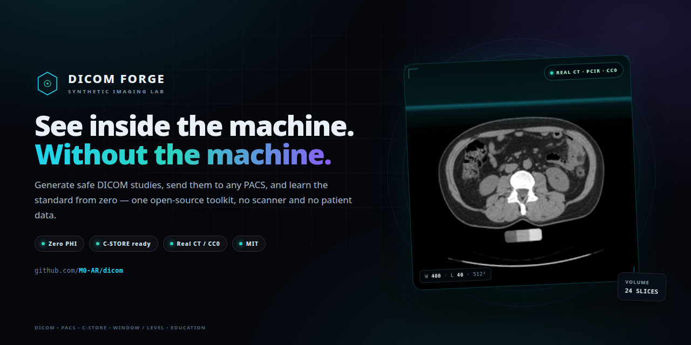
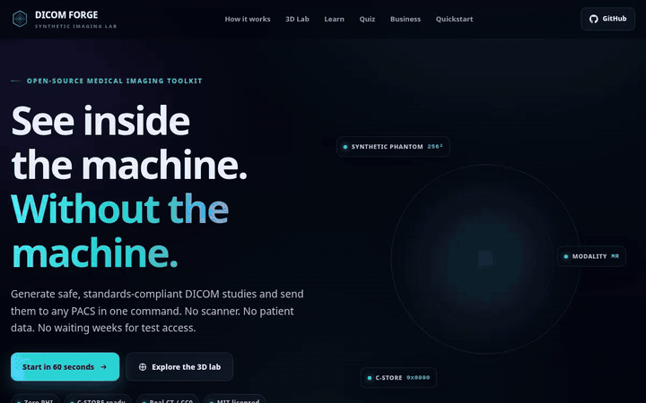
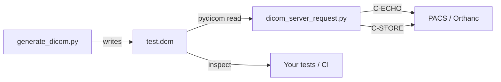

<p align="center">
  
</p>

<h1 align="center">DICOM Forge</h1>
<p align="center"><strong>Synthetic medical imaging, from zero to PACS.</strong><br>
Generate safe DICOM studies, send them over real C-STORE, and learn the standard in your browser.</p>

<p align="center">
  <a href="https://m0-ar.github.io/dicom/"></a>
  
  
  
  
</p>

> **The business problem in one paragraph.** Every imaging integration project needs a test study, a PACS connection, and a safe way to prove the workflow works. Getting those three things can take weeks of procurement, privacy review, and scanner scheduling. DICOM Forge collapses that critical path into two small Python scripts and one command. It generates standards-compliant DICOM studies with no patient data, sends them over a real DICOM association, and ships an interactive browser lab that teaches the standard to anyone on the team. The result is faster integration, lower engineering cost, zero PHI exposure, and a team that can speak the language of radiology.

---

## Table of contents

- [Why this exists](#why-this-exists)
- [See it in action](#see-it-in-action)
- [What you get](#what-you-get)
- [Quickstart (60 seconds)](#quickstart-60-seconds)
- [How it works](#how-it-works)
- [The interactive lab](#the-interactive-lab)
- [🌱 Beginner guide](#-beginner-guide--read-this-and-you-are-a-professional)
- [Business value and user stories](#business-value-and-user-stories)
- [Real data and attribution](#real-data-and-attribution)
- [Project structure](#project-structure)
- [Usage](#usage)
- [Docker test PACS](#docker-test-pacs)
- [Testing](#testing)
- [Security and privacy](#security-and-privacy)
- [Deploy](#deploy)
- [Roadmap](#roadmap)
- [Contributing](#contributing)
- [License](#license)

---

## Why this exists

Medical imaging software is tested against a moving target. A study is not just an image: it is a patient, a study, a series, a stack of instances, a transfer syntax, a set of UIDs, a network association, and a receiving PACS that may interpret all of it differently from the last one.

Teams usually solve this with one of three bad options:

1. **Wait for clinical data.** Weeks of approvals, privacy review, and data-use agreements before a single test file exists.
2. **Hand-craft a file.** A one-off script, a forgotten UID, a missing tag, and a test suite that passes locally but fails in staging.
3. **Use a vendor demo.** A black box that cannot be committed, versioned, inspected, or run in CI.

DICOM Forge gives you a fourth option: a small, readable, MIT-licensed toolkit that creates a valid study on demand, sends it through the same protocol a scanner uses, and explains every moving part in plain language. It is designed for developers, QA engineers, sales engineers, educators, and anyone who needs to understand medical imaging without a hospital behind them.

**What success looks like:** a new engineer clones the repo, generates a study, sends it to a local PACS, opens the browser lab, and can explain what happened — in under an hour.

---

## See it in action

<p align="center">
  
</p>

The live site is a single static page with no backend:

**https://m0-ar.github.io/dicom/**

It includes:

- a real, de-identified CT slice with true Hounsfield-unit window/level controls;
- a rotatable 3D stack built from 24 real CT slices;
- a DICOM tag decoder with grouped concepts and value representations;
- a 10-question quiz with explanations;
- an interactive ROI model for the business case;
- a 60-second quickstart that mirrors the commands in this README.

---

## What you get

| Capability | What it does | Why it matters |
|---|---|---|
| **Synthetic generator** | Writes a valid MR Image Storage Part 10 file with a deterministic phantom and zero patient data. | A safe test asset you can commit, share, and regenerate anywhere. |
| **C-STORE sender** | Opens a real DICOM association, optionally runs C-ECHO, and stores the instance on a PACS. | Exercises the same network path a modality uses — not a mock. |
| **Interactive lab** | Real CT window/level, HU readout, 3D slice stack, tag decoder, quiz, and ROI model. | Teaches the standard and gives demos a live, memorable artifact. |
| **Test suite** | Pytest coverage for generation, metadata, pixel data, UID uniqueness, and file format. | Makes changes safe and gives CI something real to run. |
| **Docker test PACS** | One command to run Orthanc locally and receive studies. | A complete integration loop on a laptop, with no clinical system. |
| **MIT license** | Code is free to use, modify, and ship. | Removes legal friction for internal tools, demos, and teaching. |

The generated study is intentionally small and deterministic. The real CT data used by the website is separate, de-identified, and CC0; see [Real data and attribution](#real-data-and-attribution).

---

## Quickstart (60 seconds)

### 1. Clone and install

```bash
git clone https://github.com/M0-AR/dicom.git
cd dicom

python3 -m venv .venv
source .venv/bin/activate          # Windows: .venv\Scripts\activate
pip install -r requirements.txt
```

Python 3.10 or newer is recommended.

### 2. Generate a safe study

```bash
python generate_dicom.py
```

Expected output:

```text
Created test.dcm (132,408 bytes) with zero patient data.
```

The exact byte count can change when the generator evolves. The file is a valid DICOM Part 10 image with:

- modality `MR`;
- a `256 × 256`, 16-bit synthetic phantom;
- unique Study, Series, and SOP Instance UIDs;
- synthetic patient name and ID;
- no real patient identifiers.

### 3. Inspect it

```bash
python - <<'PY'
import pydicom

ds = pydicom.dcmread("test.dcm")
print("Patient:", ds.PatientName, ds.PatientID)
print("Modality:", ds.Modality)
print("Study UID:", ds.StudyInstanceUID)
print("Image size:", ds.Rows, "x", ds.Columns)
print("Bits allocated:", ds.BitsAllocated)
PY
```

### 4. Send it to a PACS

Start a local PACS with Docker:

```bash
docker compose up -d
```

Then send:

```bash
python dicom_server_request.py --echo
```

Expected output:

```text
Connecting to 127.0.0.1:4242 as DICOM_TOOLKIT -> ORTHANC ...
C-ECHO status: 0x0000 (DICOM connectivity confirmed)
C-STORE status: 0x0000
Stored 1.2.826.0.1.3680043.8.498.... successfully.
```

Open the Orthanc web viewer at **http://localhost:8042** and confirm the study is there.

> No Docker? Point the sender at any DICOM node you control:
> `python dicom_server_request.py --host 10.0.0.5 --port 11112 --called-ae MY_PACS`.

---

## How it works



The generator builds a `pydicom.Dataset`, attaches `FileMetaDataset`, encodes the pixel array as little-endian `uint16`, and writes a valid Part 10 file. The sender reads that file, requests the matching SOP Class presentation context, opens an association, optionally verifies connectivity with C-ECHO, and sends the instance with C-STORE.

There is no mock server in the happy path. The bytes go over TCP using the DICOM Upper Layer Protocol, the same protocol used by imaging modalities and PACS.

---

## The interactive lab

The website is not a screenshot gallery. It is a small teaching instrument:

- **Real CT, real HU.** The 2D viewer uses a de-identified CTA slice at 512 × 512. The default window is `W 400 / L 40` (soft tissue). Hover the image to read the Hounsfield value under the pointer.
- **Four clinical presets.** Soft tissue, bone, lung, and brain settings show how the same pixels produce different diagnostic views.
- **A 3D stack from real slices.** Twenty-four axial slices are loaded as textures and arranged into a rotatable volume. Spacing and slice count are adjustable.
- **Tags and VRs.** A decoder explains patient, study, series, and image tags, value representations, and why a PACS sometimes rejects a file.
- **A quiz with explanations.** Ten questions cover the hierarchy, UIDs, transfer syntax, windowing, and networking. Every answer includes a short reason.
- **An ROI model.** Adjust studies per week, minutes saved, and blended hourly cost to see the engineering time the toolkit can return.

The lab is progressive enhancement: if WebGL is unavailable, the 2D viewer and all learning content still work.

---

## 🌱 Beginner guide — read this and you are a professional

This section assumes you have never opened a DICOM file. Read it once, run the commands, and the vocabulary in the rest of the repo will stop feeling like jargon.

### 1. DICOM is three things at once

Most introductions say “DICOM is the standard for medical images.” That is true but incomplete. DICOM defines:

1. **An information model** — how a patient, study, series, and image relate to each other.
2. **A file format** — how tags and pixel data are encoded on disk.
3. **A network protocol** — how systems exchange studies and verify connections.

A `.dcm` file is one representation of the model. A C-STORE request is another. The same concepts appear in both.

### 2. The patient → study → series → instance hierarchy

```text
Patient
└── Study            one imaging encounter (e.g. "CT abdomen")
    └── Series       one acquisition protocol (e.g. "axial portal venous")
        └── Instance one image or one frame (e.g. slice 42)
```

A **study** is what a radiologist reads. A **series** is a group of images acquired together with the same geometry and protocol. An **instance** is one SOP Instance — usually one image.

This hierarchy is why a PACS can show “1 study, 3 series, 214 images” without guessing. The relationships are carried in UIDs.

### 3. Tags, groups, elements, and VRs

A DICOM file is a list of data elements. Each element has:

- a **tag**: `(group, element)`, usually written in hexadecimal;
- a **value representation (VR)**: the data type, such as `PN`, `CS`, `UI`, or `OW`;
- a **value multiplicity (VM)**: how many values are allowed;
- a **value**: the actual content.

Common tags you will meet immediately:

| Tag | Name | VR | What it means |
|---|---|---|---|
| `(0010,0010)` | PatientName | PN | The patient's name. In synthetic data, invented. |
| `(0010,0020)` | PatientID | LO | The hospital or system identifier. |
| `(0008,0060)` | Modality | CS | `MR`, `CT`, `US`, `CR`, and so on. |
| `(0020,000D)` | StudyInstanceUID | UI | Globally unique identifier for the study. |
| `(0020,000E)` | SeriesInstanceUID | UI | Globally unique identifier for the series. |
| `(0008,0018)` | SOPInstanceUID | UI | Globally unique identifier for this instance. |
| `(7FE0,0010)` | PixelData | OW/OB | The encoded image pixels. |

A tag is not “metadata” in the casual sense. It is part of the clinical record. Wrong values can merge two patients, split one study into two, or make a PACS reject an otherwise valid image.

### 4. UIDs: the identity system

A **UID** (Unique Identifier) is a dotted-decimal string. DICOM UIDs are designed to be globally unique without a central registry. The important rules:

- Generate a new UID for every new study, series, and instance.
- Never reuse a SOP Instance UID for different content.
- Keep the same Study Instance UID for all images in one study.
- Keep the same Series Instance UID for all images in one acquisition.
- Do not put patient identifiers inside a UID. They are not a place for PHI.

This repo uses `pydicom.uid.generate_uid()`, which creates a UUID-derived UID under the `2.25` root. That is valid and avoids collisions.

### 5. Transfer syntax: how bytes are encoded

A **transfer syntax** tells the reader how the data set is encoded. Two common families:

- **Explicit VR Little Endian** — every element includes its VR; byte order is little-endian. This is the default in this repo because it is easy to inspect and widely supported.
- **Implicit VR Little Endian** — the VR is implied by the dictionary; smaller, but less self-describing.

Compressed syntaxes (JPEG, JPEG-LS, JPEG 2000, RLE) store pixel data differently. A file can be valid DICOM and still fail because the receiver did not negotiate the right transfer syntax. That is a **presentation context** problem, not a “bad file” problem.

### 6. Pixel data, Hounsfield units, window, and level

For CT, stored pixel values are integers. The physical meaning comes from two tags:

```text
Hounsfield units = stored pixel value × RescaleSlope + RescaleIntercept
```

A typical CT has `RescaleIntercept = -1024`, so stored value `1024` is approximately `0 HU` (water). Air is about `-1000 HU`; bone is several hundred to over `1000 HU`.

A monitor cannot display the full HU range at once with useful contrast, so viewers apply a **window**:

```text
lower = level - width / 2
upper = level + width / 2
display = clamp((HU - lower) / width, 0, 1)
```

- **W 400 / L 40** — soft tissue. Good for liver, kidney, muscle, and fat.
- **W 2000 / L 400** — bone. Wider window, bright cortex.
- **W 1500 / L -600** — lung. Centers on air-filled lung.
- **W 80 / L 40** — brain. Narrow window, high contrast, noisy outside the brain.

The same pixel data can look normal, washed out, or empty depending on these two numbers. This is why “the image looks wrong” is often a display problem, not a data problem.

### 7. Modalities and SOP classes

A **modality** is the imaging method: `MR`, `CT`, `US`, `CR`, `DX`, `PT`, and others. A **SOP Class** identifies the object and the service that operates on it. This repo uses `MRImageStorage`, so the generated file declares the MR Image Storage SOP Class and the sender requests that presentation context.

Two SOP classes are worth knowing before your first integration:

- **Verification** (`1.2.840.10008.1.1`) — the C-ECHO service. It proves the association works without sending an image.
- **MR Image Storage** (`1.2.840.10008.5.1.4.1.1.4`) — the object used by `test.dcm`.

### 8. PACS, AE titles, associations, and C-STORE

A **PACS** (Picture Archiving and Communication System) stores and retrieves images. A **DICOM node** is any system that speaks the protocol. Each node has an **AE title** — a short name such as `ORTHANC` or `DICOM_TOOLKIT`.

A **C-STORE** exchange looks like this:

1. The sender opens a TCP connection.
2. Both sides negotiate an **association**: application context, presentation contexts, transfer syntaxes, and roles.
3. The sender optionally performs **C-ECHO** to confirm connectivity.
4. The sender performs **C-STORE** for each instance.
5. The receiver returns a status code: `0x0000` is success; `0xB000`–`0xBFFF` are warnings; other values indicate failure.
6. The association is released.

If the association is rejected, check the host, port, and AE titles first. If the association succeeds but the store fails, check the SOP Class, transfer syntax, and required attributes.

### 9. DICOMweb: the HTTP side

Modern systems increasingly expose DICOM over HTTP:

- **QIDO-RS** — query studies, series, and instances.
- **WADO-RS** — retrieve objects, metadata, or frames.
- **STOW-RS** — store objects.

The concepts are the same; the transport is HTTP instead of the DICOM Upper Layer Protocol. If you understand studies, series, instances, UIDs, and transfer syntaxes, DICOMweb is a new API over familiar data.

### 10. Read a file yourself

```python
import pydicom

ds = pydicom.dcmread("test.dcm")

print(ds.PatientName)                 # synthetic name
print(ds.StudyInstanceUID)           # study identity
print(ds.SeriesInstanceUID)          # series identity
print(ds.SOPInstanceUID)             # instance identity
print(ds.Modality)                   # MR
print(ds.Rows, ds.Columns)           # 256 256
print(ds.BitsAllocated)              # 16
print(ds.file_meta.TransferSyntaxUID)
print(ds.pixel_array.shape)          # (256, 256)
```

`pydicom` decodes the file; `numpy` gives you the pixel array. From there you can window, measure, annotate, or convert to another format.

### 11. The traps that break real integrations

- **PHI in unexpected places.** Patient name is obvious. Free-text fields, private tags, and burnt-in annotations are not. A “de-identified” file can still leak.
- **New UID for old content.** Reusing a SOP Instance UID with different pixels corrupts identity and caching.
- **One series, two geometries.** Mixing slice spacing or orientation in a series produces a broken volume.
- **Transfer syntax mismatch.** The receiver may support the SOP Class but not the encoding.
- **AE title mismatch.** A correct IP and port still fail if the called AE title is wrong.
- **Signed versus unsigned pixels.** CT often uses signed values; reading them as unsigned shifts every HU.
- **Windowing mistaken for data loss.** A narrow window can hide real anatomy. Always inspect the raw values.
- **No C-ECHO first.** Testing connectivity separately from storage turns a vague failure into a precise one.

### 12. Where to go next

- Read the [DICOM standard](https://www.dicomstandard.org/) — start with PS3.1 (overview), PS3.3 (information model), PS3.5 (encoding), and PS3.7 (network).
- Run the generator, change one tag, and observe what breaks.
- Send a file to Orthanc, then query it back with DICOMweb.
- Open the interactive lab and try all four window presets on the real CT slice.
- Read the test suite; each test is a small statement about what “valid” means.

If you can explain the hierarchy, the three UID levels, the difference between a transfer syntax and a SOP Class, and why window/level changes the display but not the stored pixels, you understand more than many people who work with medical images every day. **You will know more than most interview candidates.**

---

## Business value and user stories

### User stories

| Persona | User story | Outcome |
|---|---|---|
| **Integration engineer** | “As an integration engineer, I want a realistic test study so I can validate PACS ingestion without waiting for clinical data.” | A repeatable study in seconds, not weeks. |
| **QA engineer** | “As a QA engineer, I want deterministic DICOM files in CI so my tests do not depend on a hospital or a vendor demo.” | Tests that run on every commit and fail for real reasons. |
| **Sales engineer** | “As a sales engineer, I want a live demo that shows an image landing in a PACS.” | A credible demo without exposing customer data. |
| **Educator** | “As an educator, I want students to see windowing, tags, and networking in one place.” | A lab that makes abstract standards concrete. |
| **Engineering manager** | “As an engineering manager, I want to remove privacy review from the critical path.” | Faster onboarding and lower cost per integration. |
| **Security reviewer** | “As a security reviewer, I want a test asset with no PHI by construction.” | A smaller blast radius and a simpler approval. |

### Where the value comes from

- **Time:** replace scanner scheduling and data-use agreements with a local command.
- **Cost:** avoid paying for vendor test environments or dedicated integration hardware.
- **Risk:** keep PHI out of development, demos, and CI.
- **Quality:** exercise the real protocol, including association negotiation and status codes.
- **Communication:** a live 3D lab gives non-engineers a way to see what the team is building.

The ROI panel on the website is illustrative. Replace its defaults with your own loaded cost and test volume to build an internal business case.

---

## Real data and attribution

The **generator** in this repository produces a synthetic phantom. It does not contain real patient data.

The **interactive website** uses de-identified CT imagery to teach window/level and volume rendering:

- **Source:** PCIR dataset, series `98890234_20010101`, “CTA AORTA”.
- **Record:** Zenodo record `18225140`.
- **DOI:** [10.5281/zenodo.18225140](https://doi.org/10.5281/zenodo.18225140).
- **License:** CC0 1.0 Universal (public domain dedication).
- **What is used:** 24 evenly spaced axial slices, converted to 8-bit JPEG for the 3D stack, plus one 512 × 512 signed 16-bit slice for true Hounsfield-unit window/level.
- **What is not used:** DICOM headers, patient identifiers, or any clinical metadata.

The CT data is used for education and demonstration only. It is not a medical device, not a diagnostic viewer, and not a substitute for clinical review.

If you reuse the CT assets, keep the attribution and comply with the CC0 terms. If you reuse the code, the MIT license applies.

---

## Project structure

```text
.
├── generate_dicom.py            # synthetic MR DICOM generator
├── dicom_server_request.py      # C-ECHO / C-STORE sender
├── test.dcm                     # generated example study
├── preview.html                 # single-page interactive site
├── index.html                   # redirects to preview.html
├── assets/
│   ├── banner.png
│   ├── demo.gif
│   ├── logo.svg
│   └── ct/
│       ├── slice.raw            # 512 × 512 int16 HU slice (2D viewer)
│       └── slices/              # 24 JPEG slices (3D stack)
├── tests/
│   ├── conftest.py
│   └── test_dicom_toolchain.py
├── requirements.txt
├── docker-compose.yml
├── docker/
│   └── orthanc.json
├── .github/workflows/ci.yml
├── .nojekyll
├── LICENSE
└── README.md
```

---

## Usage

### Generate a study with custom synthetic identifiers

```bash
python generate_dicom.py \
  --output studies/patient-a.dcm \
  --patient-name "SYNTHETIC^PATIENT_A" \
  --patient-id "SYN-0002"
```

The identifiers are still synthetic. Do not use real patient names or IDs in a test asset.

### Send a file

```bash
python dicom_server_request.py \
  --file studies/patient-a.dcm \
  --host 127.0.0.1 \
  --port 4242 \
  --calling-ae DICOM_TOOLKIT \
  --called-ae ORTHANC \
  --echo
```

Environment variables are supported for the network settings:

```bash
export DICOM_HOST=127.0.0.1
export DICOM_PORT=4242
export DICOM_CALLING_AE=DICOM_TOOLKIT
export DICOM_CALLED_AE=ORTHANC
python dicom_server_request.py --echo
```

### Check connectivity without storing

C-ECHO is the DICOM equivalent of a ping. It verifies the association and AE titles without sending an image. Use `--echo` before a demo or a CI run.

### Common status codes

| Status | Meaning | First thing to check |
|---|---|---|
| `0x0000` | Success | Nothing. |
| `0xB000`–`0xBFFF` | Warning / coercion | PACS logs; the instance may be stored with modified attributes. |
| `0x0122` | SOP Class not supported | Presentation context and receiver configuration. |
| `0x0124` | Not authorized | AE title allow-list or access control. |
| Association rejected | Transport / identity failure | Host, port, called AE title, firewall. |

---

## Docker test PACS

`docker-compose.yml` runs Orthanc with DICOM on `4242` and HTTP on `8042`:

```bash
docker compose up -d
docker compose logs -f orthanc
```

Then:

```bash
python generate_dicom.py
python dicom_server_request.py --echo
```

Open **http://localhost:8042** to inspect the study. The compose file is for local development only. It has no TLS and no authentication; do not expose it to an untrusted network.

Stop and remove the data:

```bash
docker compose down -v
```

---

## Testing

```bash
pip install -r requirements.txt
pytest -q
```

The suite checks:

- the output file exists and is non-empty;
- required patient and study attributes are present;
- pixel data has the expected shape and dtype;
- Study, Series, and SOP Instance UIDs are unique;
- the file is valid DICOM Part 10 with file meta information;
- the phantom is deterministic for a fixed seed.

CI runs the suite on every push and pull request, then generates a fresh study and inspects it with `pydicom`.

---

## Security and privacy

- **No real patient data.** The generator creates synthetic identifiers and a synthetic pixel array.
- **No PHI in the repository.** The CT assets are de-identified and CC0; headers are not included.
- **No clinical use.** This is an engineering and education toolkit, not a medical device.
- **Local PACS only.** The Docker setup has no authentication or TLS. Use it on a trusted machine.
- **Review before adapting.** If you connect this to a clinical network, perform your own security, privacy, and regulatory review.
- **Do not weaken de-identification.** If you add real data later, remove identifiers, private tags, burnt-in annotations, and free-text fields before committing anything.

DICOM® is a registered trademark of the National Electrical Manufacturers Association.

---

## Deploy

The site is static. `preview.html` loads its assets with relative paths, so it can be served from any static host.

### GitHub Pages

1. Push the repository to GitHub.
2. Open **Settings → Pages**.
3. Set **Source** to `Deploy from a branch`, branch `main`, folder `/ (root)`.
4. Open **https://m0-ar.github.io/dicom/**.

`index.html` redirects to `preview.html`, so the root URL works without a build step.

### Any static host

Upload `preview.html`, `index.html`, and `assets/` to the same directory. No server-side runtime is required.

---

## Roadmap

- [ ] Multi-frame DICOM and enhanced CT/MR objects.
- [ ] Batch generation and directory-level C-STORE.
- [ ] DICOMweb client examples (QIDO-RS, WADO-RS, STOW-RS).
- [ ] TLS and certificate-based associations.
- [ ] More modalities: CT, ultrasound, X-ray.
- [ ] A CLI wrapper that generates and sends in one command.
- [ ] A structured “DICOM in 10 minutes” lesson track for classrooms.

---

## Contributing

Issues and pull requests are welcome. Please:

1. Open an issue describing the change or bug.
2. Keep changes focused and add or update tests.
3. Run `pytest -q` before opening a pull request.
4. Do not add real patient data, private tags, or clinical images with identifiers.
5. Keep the website accessible: keyboard navigation, reduced-motion support, and readable contrast are part of the product.

If you are new to DICOM, the beginner guide above is the fastest way to get oriented. If you are new to the codebase, start with `generate_dicom.py`; it is intentionally small.

---

## License

Code is released under the **MIT License**. See [LICENSE](LICENSE).

The CT imagery in `assets/ct/` is derived from the PCIR dataset and is dedicated to the public domain under **CC0 1.0**. See [Real data and attribution](#real-data-and-attribution).

---

<p align="center"><sub>Built for engineers, educators, and anyone who wants to see inside the machine — without the machine.</sub></p>
